# 1 · Install Auraclip and set up everything

About 10 minutes. Every step except installing is optional and can be done later. The app works
right after install, and each step below switches on one more feature.

**You need:** Windows 10 or 11 (64-bit), 8 GB of RAM (16 GB recommended) and about 3 GB of free
space. A graphics card (NVIDIA, AMD or Intel) makes it faster but isn't required.

## Step 1 · Download
1. Go to **getauraclip.pages.dev** and press **Download free trial**. This opens the latest
   release on GitHub.
2. Under **Assets**, click **Auraclip-Setup-x.y.z.exe** (about 900 MB).

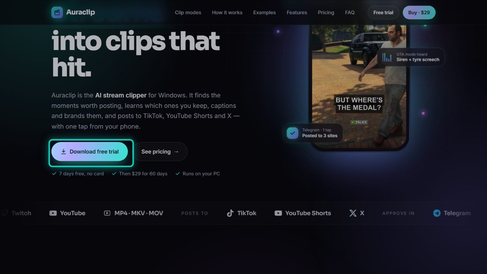

## Step 2 · Install
1. Double-click the downloaded file.
2. If Windows shows **"Windows protected your PC"**, click **More info → Run anyway**. Auraclip is
   new, so Windows doesn't know it yet.
3. Accept the licence agreement and press **Next**.
4. Optional ticks:
   - **Create a desktop shortcut**
   - **Start Auraclip with Windows (it waits in the tray)**: handy if you clip from your phone
     via Telegram.
5. Press **Install**, then **Finish**.

No admin rights are needed: Auraclip installs for your Windows user only.

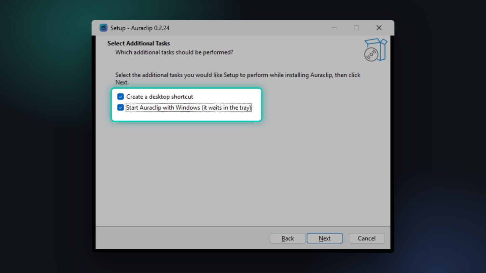

## Step 3 · First start
Auraclip opens with a **Welcome** window that lists four quick things. You can press
**Start clipping** and do them later.

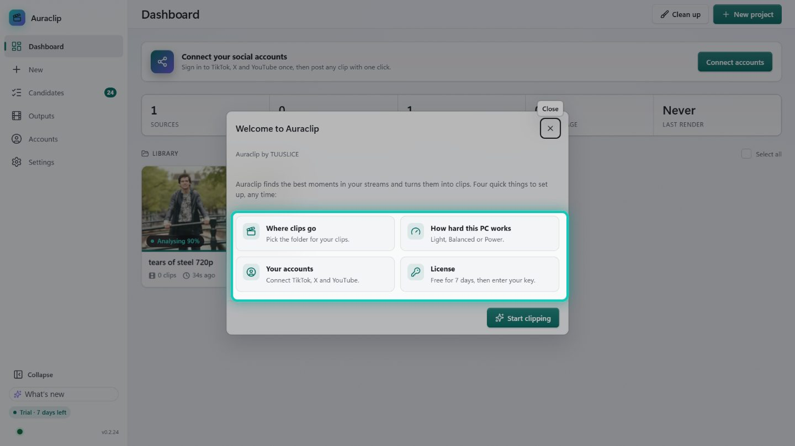

Your free trial starts right away: 7 days of everything. Pro features (Engagement Studio, auto
posting with music, GTA / Anime editions) also get 3 free tries each.

> Closing the window keeps Auraclip running in the **tray** (next to the clock), so Telegram and
> agents can still reach it. To really stop it: right-click the tray icon → **Quit**.

## Step 4 · Where clips go
**Settings → General → Clips folder.** By default it's `Videos\Auraclip`. Press **Change…** to pick
another drive, then **Test** and **Save**. Each video gets its own folder with `clips`, `captions`,
`gifs` and `source` inside.

Same page: **Appearance** (Windows setting, Dark or Light) and **Theme pack**.

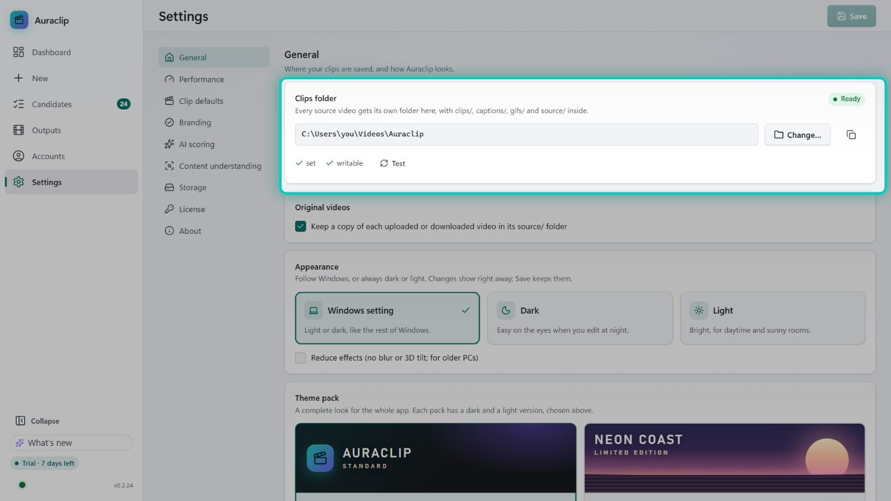

## Step 5 · How hard this PC works
**Settings → Performance.** Pick one:

| Mode | Best for |
|---|---|
| **Light** | Laptops, or while you game or stream |
| **Balanced** (recommended) | Most PCs |
| **Power** | NVIDIA GPU and 16 GB+ RAM: the best captions and scoring (downloads ~1.5 GB once) |

The **This PC** card shows what Auraclip found (processor, memory, graphics card, video encoder) and
which mode it recommends. Press **Save**.

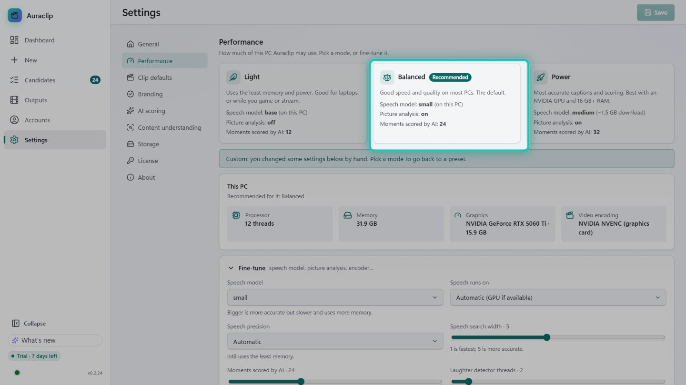

## Step 6 · Smarter clips with a local AI (optional)
**Settings → AI scoring → Set up automatically.** If **LM Studio** or **Hermes** is on your PC,
Auraclip connects to it and helps you pick a model. If neither is installed, Auraclip can install
LM Studio and the right model for you.

Without AI, Auraclip still ranks the moments itself. Full details are in
[guide 3](03-local-ai-and-agents.md).

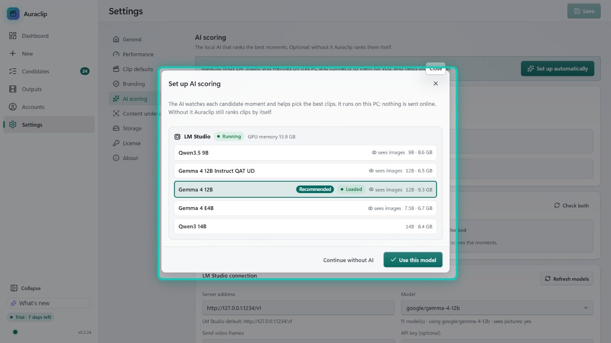

## Step 7 · Connect TikTok, YouTube and X
**Accounts.** Press **Connect** next to each site. A separate **Auraclip browser window** opens:
sign in there as usual, then close it. Auraclip never sees your password. The sign-in stays in that
window only, apart from your normal browser.

Then set your **Posting** options on the same page:
- **Who can see new posts:** Everyone, or private while you test.
- **TikTok & YouTube shape:** 9:16 Fill is the usual choice. X always gets a 16:9 cut.
- **Hashtags:** 5 is a good number. X never gets hashtags.
- **Browser to post with:** Automatic picks Brave, then Chrome, then Edge.

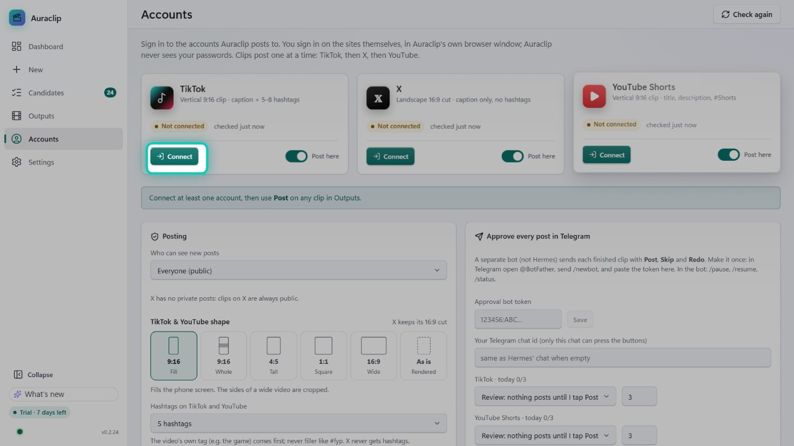

## Step 8 · Approve posts from your phone (Telegram)
Every finished clip comes to Telegram as a card with **Post**, **Skip** and **Redo**.
1. In Telegram, open **@BotFather**, send `/newbot`, and pick a name and a username ending in `bot`.
2. BotFather sends a **token** (looks like `123456789:AA…`). Paste it into **Accounts → Approve every
   post in Telegram → Approval bot token** and press **Save**.
3. Send `/start` to **@userinfobot** to see your **Id** number. Paste it into **Your Telegram chat id**.
4. Open your new bot and press **Start**.
5. Per site choose **Review** (nothing posts until you tap Post), **auto above a score** or **full
   auto**, and a **daily cap**.

In the bot: `/pause`, `/resume`, `/status`.

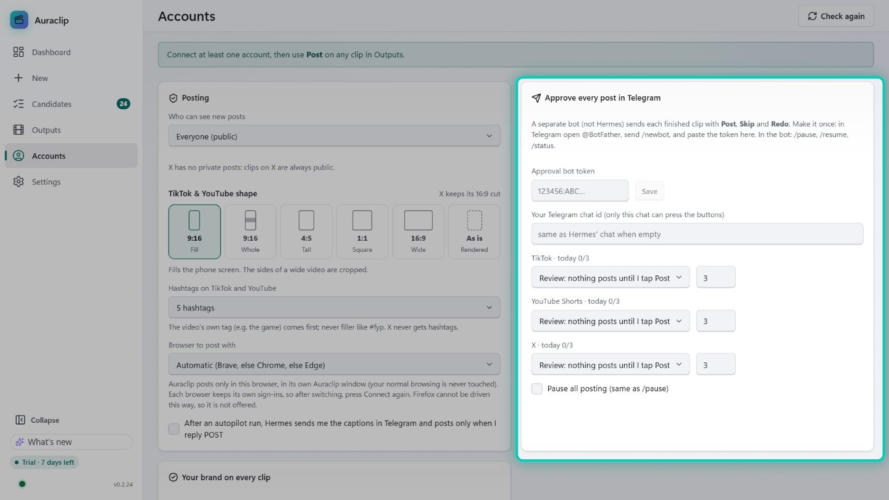

## Step 9 · Your brand on every clip
**Settings → Branding.** Press **Upload logo** (a PNG with a transparent background looks best),
type your username (for example your Kick name), and pick a **Position** and **Motion**. The preview
shows exactly what the export looks like. Press **Save**.

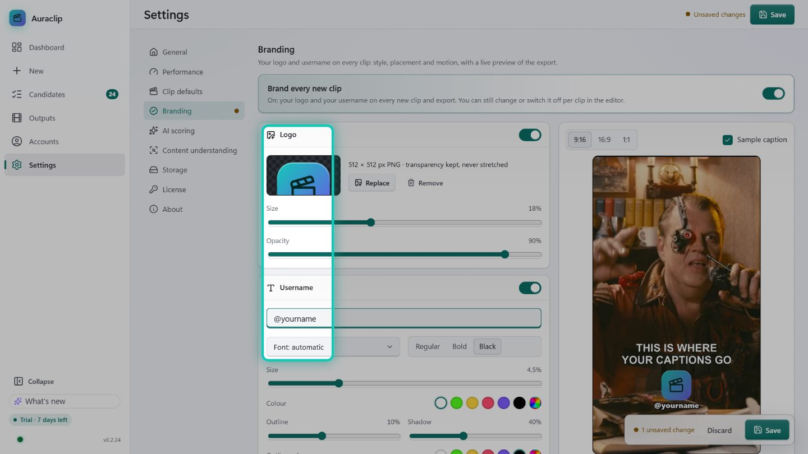

## Step 10 · Music and smarter captions (optional, free keys)
- **Music:** **Settings → Clip defaults → Music.** Make a free account at **devportal.jamendo.com**,
  create an app, paste its **client id**, then press **Test** and **Save**. The editor's **Music** tool
  can then search 600,000+ free tracks. Keep **"Only music that is OK for monetised videos"**
  ticked.
- **Content understanding:** **Settings → Content understanding.** Press **Download (95 MB)** next to
  **Picture check** so Auraclip can tell a game from a podcast. Optional: IGDB or RAWG keys give
  more accurate game names.

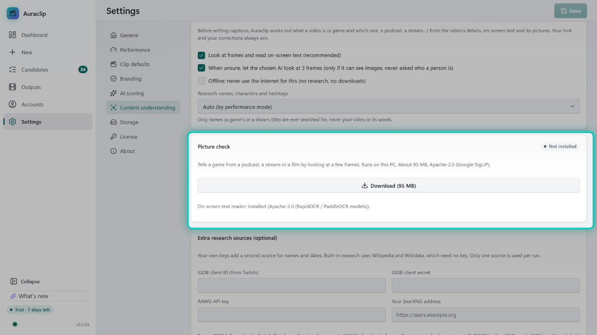

## Step 11 · Licence and updates
- **Settings → License:** paste the key from your Gumroad email and press **Activate**. One key
  works on 2 PCs. Moving to a new PC? Press **Deactivate this PC** first.
- **Settings → About:** **Check for updates**. Leave **Check for updates automatically** on.

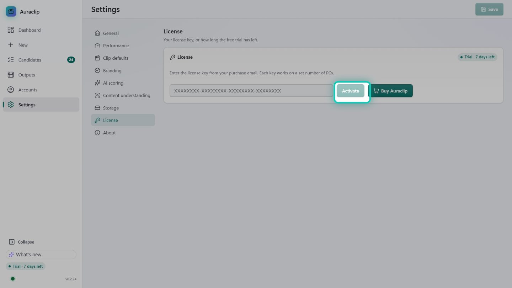

✅ Done. Next: [How to use Auraclip](02-using-auraclip.md)
