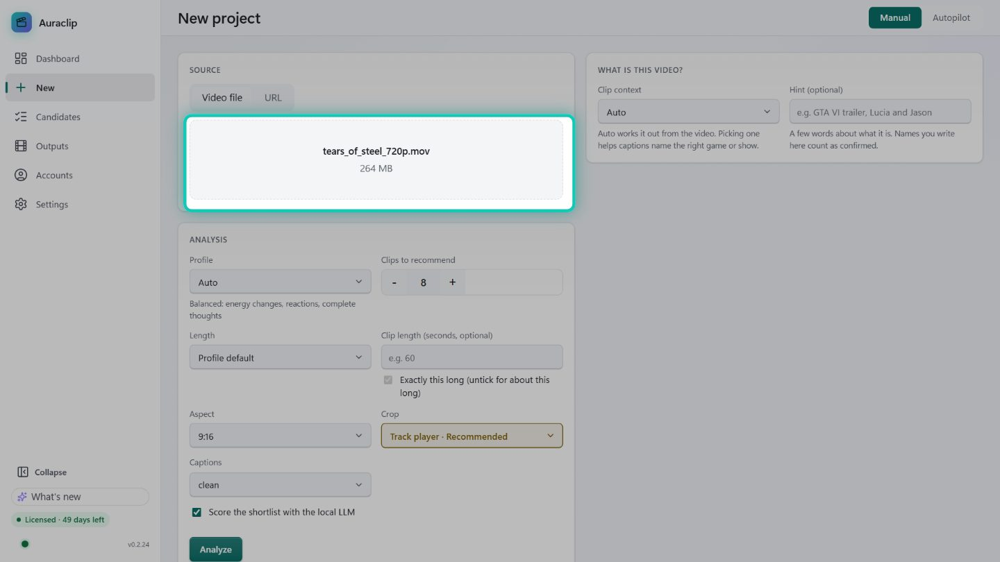
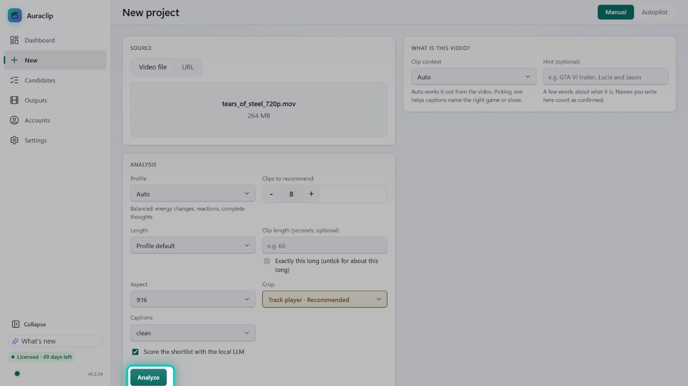
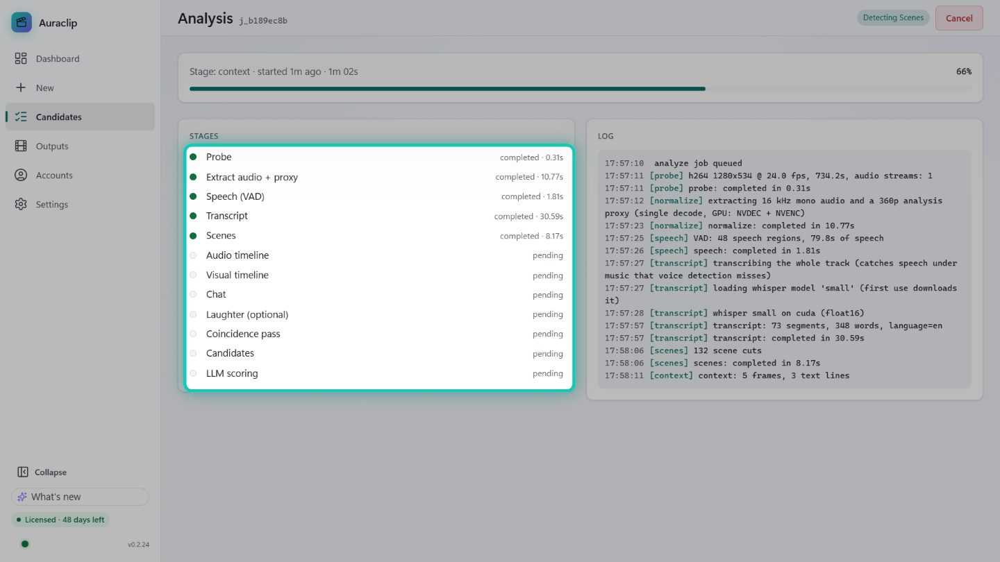
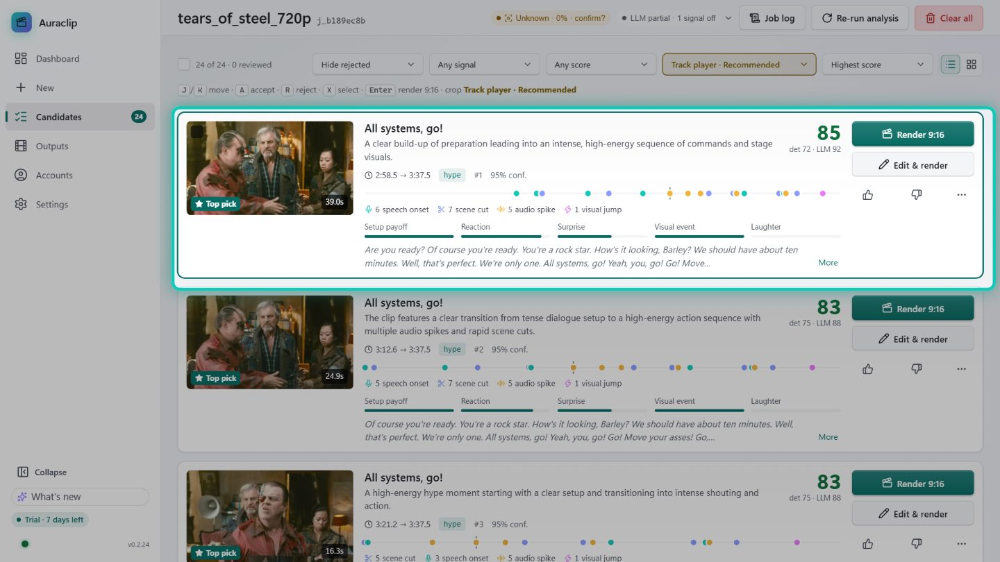
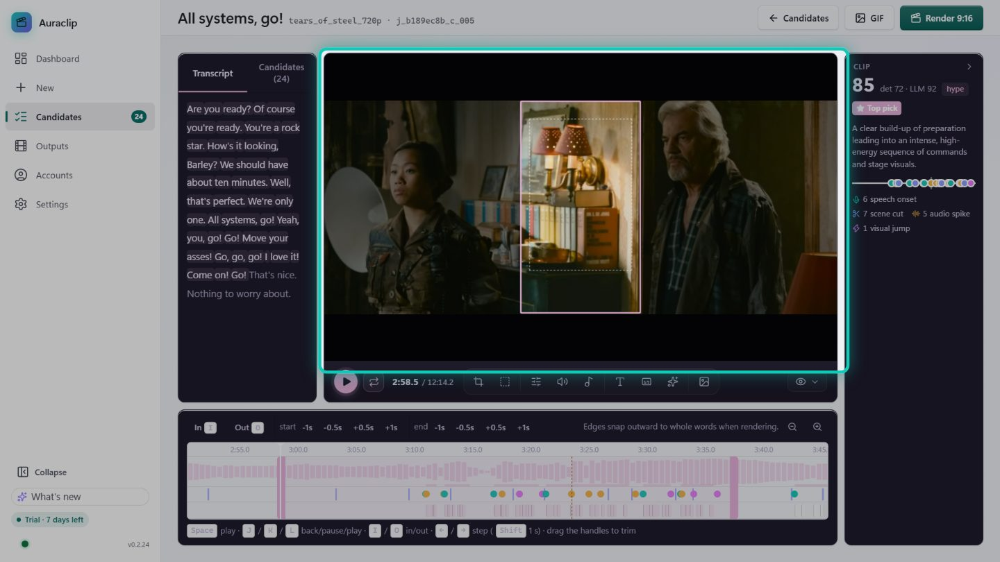
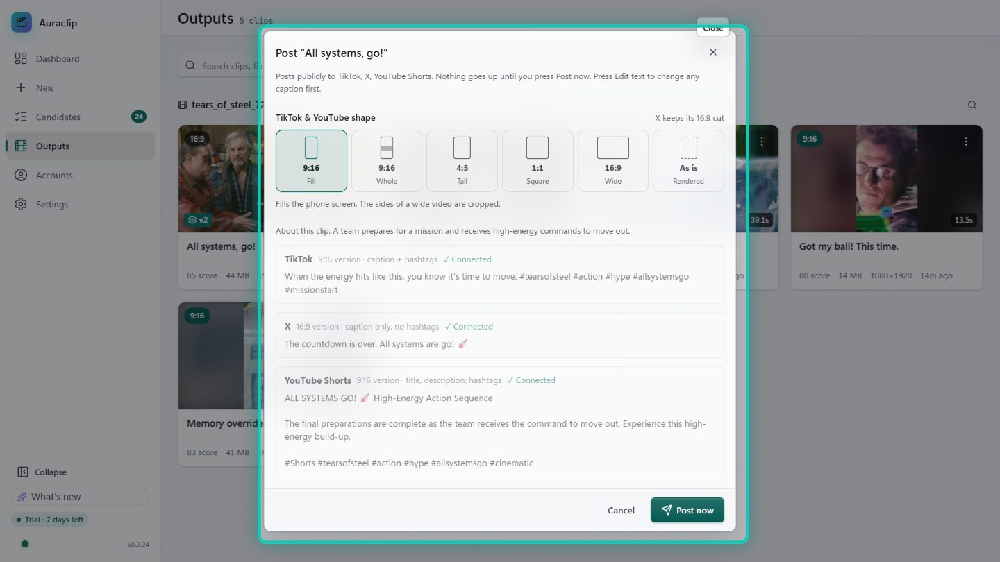

# 2 · How to use Auraclip: from video to posted clip

It takes four steps: **add a video → review the candidates → polish in the editor → post**.

## Step 1 · Add a video
1. Click **New** in the left menu.
2. Either **drop a video file**, or click to choose one (MP4, MOV, MKV, WebM; stream VODs work).
   Or switch to **URL**, paste a link (YouTube, Twitch, Kick…) and tick **"I have the right to
   download and process this content"**.
3. **What is this video?** (optional): **Auto** works it out, or pick a context such as a game or
   anime and type a **Hint** (for example the game's name). Names you write here count as confirmed.

### Manual or Autopilot
- **Manual:** you choose:
  - **Profile**: Auto, Funny, Reaction, Gaming, Meme, Podcast or Hype.
  - **Clips to recommend**.
  - **Length**.
  - **Aspect**: 9:16 for TikTok and Shorts.
  - **Crop**: **Track player** follows the main person or vehicle.
  - **Captions**.

  Then press **Analyze**.
- **Autopilot:** the AI picks the settings and renders the clips by itself. Press **Analyze &
  Autopilot**.

## Step 2 · Let it analyse
Auraclip transcribes the speech (on your graphics card if you have one), finds scene cuts, audio
spikes, laughter and reactions, then the AI scores the shortlist. The **job page** shows each stage
live. Our 12-minute demo video took about 10 minutes, including the AI scoring.

## Step 3 · Review the candidates
**Candidates** lists the best moments, ranked by **score**, with a title and *why* the AI picked
each one. The best are marked **Top pick**.

- The score mixes Auraclip's own detectors (**det**) and the AI's opinion (**LLM**). The dots show
  the signals behind it: speech starts, scene cuts, audio spikes, visual jumps.
- **Render 9:16** makes a finished clip right away. **Edit & render** opens the editor first.
- 👍 / 👎 teach Auraclip your taste. After 10 decisions it leans the scoring toward what you keep.
- Keyboard: **J / K** move, **A** accept, **R** reject, **X** select, **Enter** render.

## Step 4 · Polish in the editor
- **Trim:** drag the handles on the timeline, or press **I** and **O**. Edges snap to whole words.
  Space plays, and the arrow keys step.
- **Tool bar** (Alt+1…9):

| Tool | What it does |
|---|---|
| **Crop** | Drag the frame by hand (Track player does it automatically) |
| **Canvas** | Aspect and fit: 9:16, 1:1, 16:9, crop or show the whole picture |
| **Filter** | Colour look and strength |
| **Audio** | Volume and voice clean-up |
| **Music** | Free Jamendo tracks or your own file, mixed under the voice |
| **Text** | Hooks and titles on top |
| **Captions** | Caption style, synced word by word |
| **Studio** | Engagement Studio: hooks, avatars, B-roll, sound effects (Pro, 3 free tries) |
| **GIF** | Export a GIF |

Press **Render 9:16** (top right) when it looks right.

## Step 5 · Outputs and posting
- **Outputs** shows every clip, grouped by video. The files are also in your clips folder.
- Click a clip to preview it, then **Download**, **Copy path**, **Re-render** or **Post**.
- **Post** writes a caption per site:
  - TikTok and YouTube get hashtags.
  - X gets a clean caption with no hashtags, and its own 16:9 version.
- Edit any text, then press **Post now**. Nothing goes up before that.
- With the Telegram approval bot (guide 1, step 8), every finished clip also arrives on your phone
  with **Post / Skip / Redo**.

### Telegram Bots (optional)
If you run the Hermes **Content Agent**, a **Telegram Bots** tab appears. It shows scraped news
stories you can review and post to X, TikTok and Discord.

Next: [Local AI and agents](03-local-ai-and-agents.md)
