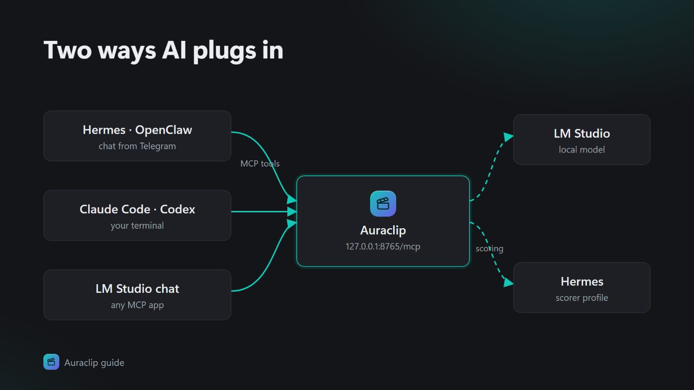
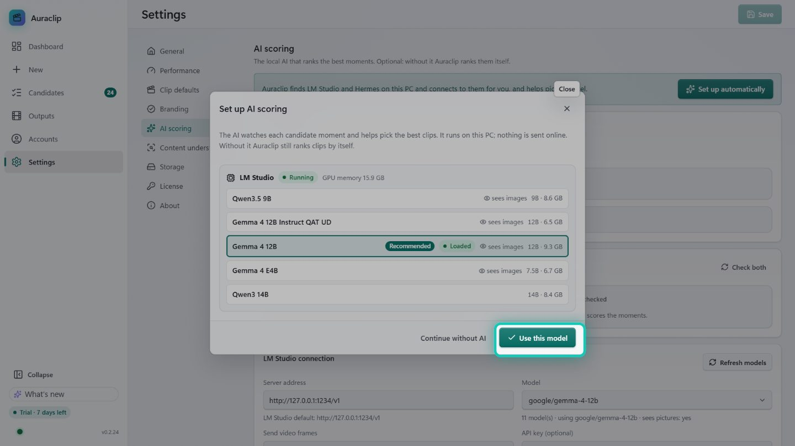
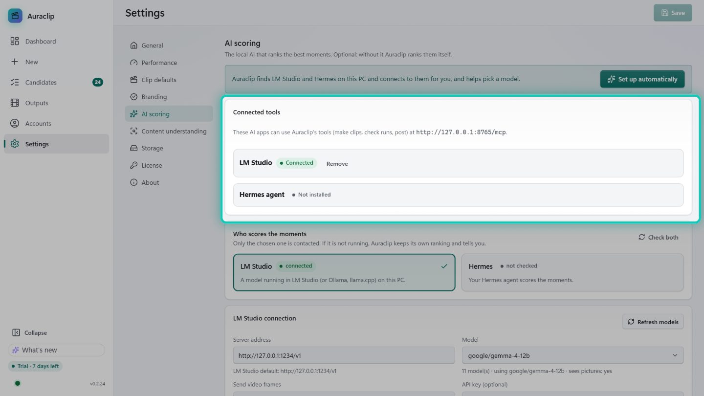
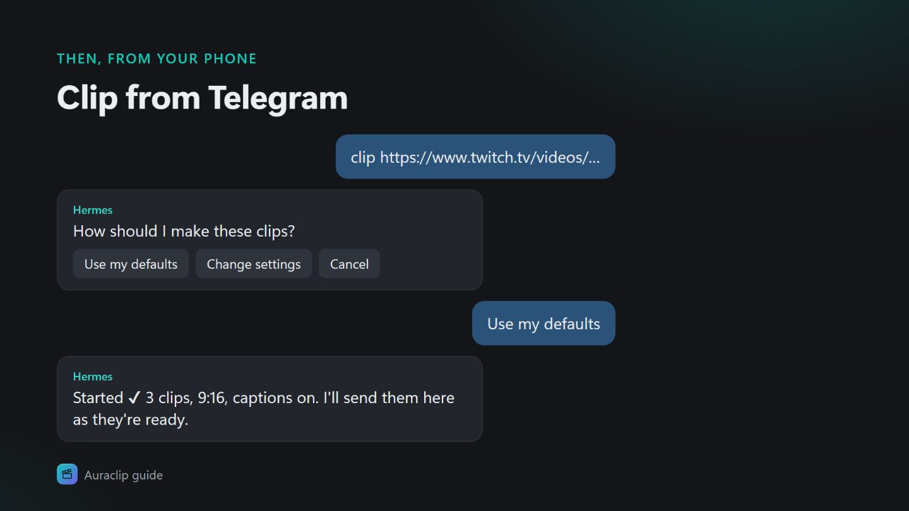

# 3 · Local AI and AI agents (LM Studio, Hermes, OpenClaw, Claude Code, Codex)

Auraclip works with no AI at all: it still finds and ranks moments by itself. A local AI makes
the ranking smarter, and an AI agent lets you make clips just by asking, for example "clip this
video" from Telegram or from your terminal.



There are two different connections:

| Connection | What it does | Who can do it |
|---|---|---|
| **AI scoring** | Ranks the best moments and writes captions | LM Studio **or** Hermes (pick one in Settings → AI scoring) |
| **MCP (agent tools)** | Lets an agent run Auraclip: make clips, check progress, post | LM Studio, Hermes, OpenClaw, Claude Code, Codex and any other MCP app |

**Auraclip's MCP address:** `http://127.0.0.1:8765/mcp`

> If port 8765 was busy when Auraclip started, it uses the next free one. Look in
> **Settings → AI scoring → Connected tools**: the line there shows the address in use.
> The agent must run **on the same PC** as Auraclip.

## Which path is for me?

| You want… | Do this |
|---|---|
| Better clips, nothing else | [LM Studio](#lm-studio) (5 minutes) |
| "Clip this link" from your phone via Telegram | [Hermes](#hermes-agent) |
| You already use an agent | The **short way** for [Claude Code](#claude-code), [Codex](#codex), [OpenClaw](#openclaw), or [any agent](#any-other-agent-the-one-prompt-way) |

---

## LM Studio

LM Studio runs AI models on your own PC for free. Auraclip uses it to score clips and can also
hand it its tools.

### Short way
1. Open **Settings → AI scoring** and press **Set up automatically**.
2. Pick the recommended model and press **Connect**. If LM Studio isn't installed yet,
   Auraclip offers to install it and download the right model for your graphics card.



### Long way
1. Download LM Studio from **lmstudio.ai** and install it.
2. Open LM Studio, click **Discover** (the magnifying glass) and download a model.

   | Your graphics card memory (VRAM) | Model to pick |
   |---|---|
   | 10 GB or more | **Gemma 4 12B (QAT)**: the model Auraclip is tuned on |
   | 8 GB | **Qwen3.5 9B** |
   | 6 GB | **Gemma 4 E4B** |
   | Less, or no GPU | **Gemma 4 E2B** |

3. Click **Developer** (the `>_` icon), then switch **Status: Running** on. The server listens at
   `http://127.0.0.1:1234`.
4. In Auraclip open **Settings → AI scoring**:
   - Under **Who scores the moments**, pick **LM Studio**.
   - **Server address**: `http://127.0.0.1:1234/v1` (the default).
   - Press **Refresh models**, pick your model, then press **Save**.
5. Under **Connected tools**, LM Studio should say **Connected**. If it says **Not connected**,
   press **Connect**. This adds Auraclip to LM Studio's `mcp.json`.
6. In an LM Studio chat, switch on the **auraclip** tool and ask:
   *"Make 3 clips from D:\Videos\my-stream.mp4"*.



---

## Hermes agent

Hermes is a free AI agent that you can talk to from Telegram. With Auraclip connected you can send
it a link from your phone, answer its few questions (or "use my defaults"), and the finished clips
come back to the same chat.

### Short way (Hermes already installed)
1. Open **Settings → AI scoring → Connected tools**.
2. Next to **Hermes agent**, press **Connect**.
   Auraclip installs its skills into Hermes, adds its MCP link, turns on Hermes' API server and
   restarts Hermes. It makes a backup first.
3. Under **Who scores the moments**, pick **Hermes** and press **Save** (optional: Hermes can
   also do the scoring).

### Long way (new to Hermes)
1. Open **PowerShell** and install Hermes:
   ```powershell
   iex (irm https://raw.githubusercontent.com/NousResearch/hermes-agent/main/scripts/install.ps1)
   ```
2. Close PowerShell, open a new one, and run the setup wizard to pick a model:
   ```powershell
   hermes setup
   ```
   For a free local model, start LM Studio's server first (see above) and pick a **custom /
   OpenAI-compatible** provider at `http://127.0.0.1:1234/v1`.
3. Connect Telegram:
   ```powershell
   hermes gateway setup
   ```
   Make a bot with **@BotFather** in Telegram, paste its token, then message your bot once to pair.
4. Connect Auraclip: in Auraclip press **Connect** next to Hermes (the short way above).
   Doing it by hand instead:
   ```powershell
   hermes mcp add auraclip --url http://127.0.0.1:8765/mcp
   hermes mcp test auraclip
   ```
5. Send your bot: *"clip https://… "*. Hermes asks: **Use my defaults / Change settings / Cancel**.



---

## Claude Code

### Short way
In a terminal, run:
```bash
claude mcp add --transport http auraclip http://127.0.0.1:8765/mcp --scope user
```
Then start `claude` and type `/mcp`: **auraclip** should show as connected.

### Long way
1. Install Claude Code (see claude.com/claude-code) and sign in.
2. To use Auraclip in one project only, put this file in the project folder as `.mcp.json`:
   ```json
   {
     "mcpServers": {
       "auraclip": { "type": "http", "url": "http://127.0.0.1:8765/mcp" }
     }
   }
   ```
3. Start `claude` in that folder and approve the **auraclip** server when it asks.
4. Ask: *"Use auraclip to make 3 clips from D:\Videos\my-stream.mp4"*.

---

## Codex

### Short way
```bash
codex mcp add auraclip --url http://127.0.0.1:8765/mcp
```

### Long way
1. Open `%USERPROFILE%\.codex\config.toml` in Notepad. The Codex app and the Codex CLI share
   this file.
2. Add:
   ```toml
   [mcp_servers.auraclip]
   url = "http://127.0.0.1:8765/mcp"
   default_tools_approval_mode = "approve"
   ```
   The last line lets Codex use Auraclip's tools without asking each time. Leave it out if you'd
   rather approve every call.
3. Restart Codex and ask: *"Use auraclip's health_check"*. It should answer **ok**.

---

## OpenClaw

### Short way
Ask your OpenClaw agent:

> Add an MCP server named auraclip: url http://127.0.0.1:8765/mcp, transport streamable-http.

### Long way
In **Windows PowerShell**, run this exactly (the `\"` are needed in Windows PowerShell 5):
```powershell
openclaw mcp set auraclip '{\"url\":\"http://127.0.0.1:8765/mcp\",\"transport\":\"streamable-http\"}'
openclaw mcp show auraclip
```
Or open `%USERPROFILE%\.openclaw\openclaw.json` and add this under `"mcp"`:
```json
"servers": {
  "auraclip": { "url": "http://127.0.0.1:8765/mcp", "transport": "streamable-http" }
}
```

---

## Any other agent: the one-prompt way

Paste this into any agent that can edit its own settings (Claude Code, Codex, OpenClaw, Hermes,
Cursor, and others):

```text
Connect yourself to Auraclip's MCP server. It runs on this PC at http://127.0.0.1:8765/mcp
(Streamable HTTP, no auth by default). Instructions: https://getauraclip.pages.dev/guide/agents.md
When done, call the auraclip tool health_check and tell me the result.
```

---

## What the agent can do

By default an agent gets six simple tools:

| Tool | What it does |
|---|---|
| `clipper_setup` | Starts a run from a link or a file. It first asks you the clip settings (Use my defaults / Change settings / Cancel) |
| `clipper_status` | Shows progress: stage, step, percent, time left |
| `clipper_retry` / `clipper_cancel` | Retries or stops a run |
| `clipper_post` | Posts finished clips (only if you turned posting on) |
| `health_check` | Checks that Auraclip is ready |

**Power users:** for every step as its own tool (ingest, analyse, list candidates, render, GIF…),
open `%LOCALAPPDATA%\Auraclip\clipper.env` in Notepad, add `MCP_PROFILE=full`, then quit
Auraclip from the tray and open it again.

**Locking it down:** add `MCP_TOKEN=pick-a-long-secret` to the same file. Agents must then send the
header `Authorization: Bearer pick-a-long-secret`:
- Claude Code: add `--header "Authorization: Bearer …"` to `claude mcp add`.
- Codex: set `bearer_token_env_var`.
- Hermes: `install.ps1 -McpToken …`.

Next: [Creative: long YouTube videos](04-creative.md)
