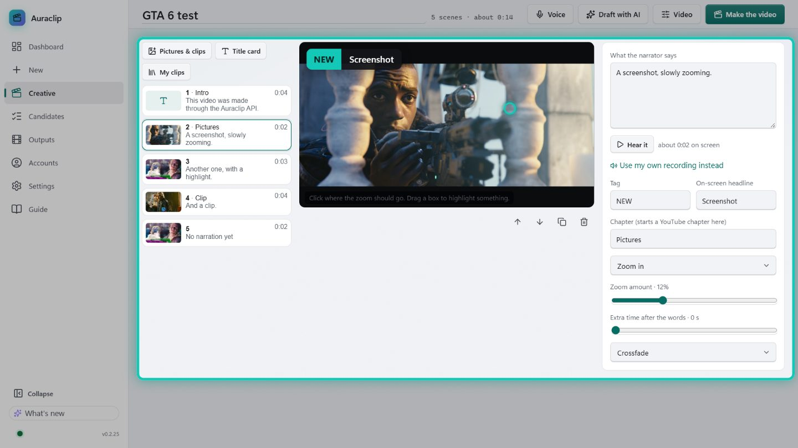
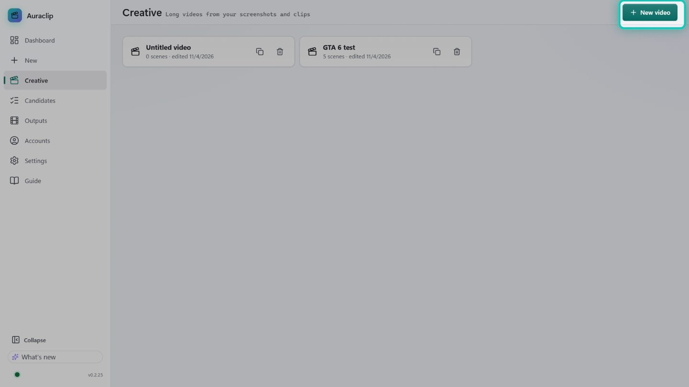
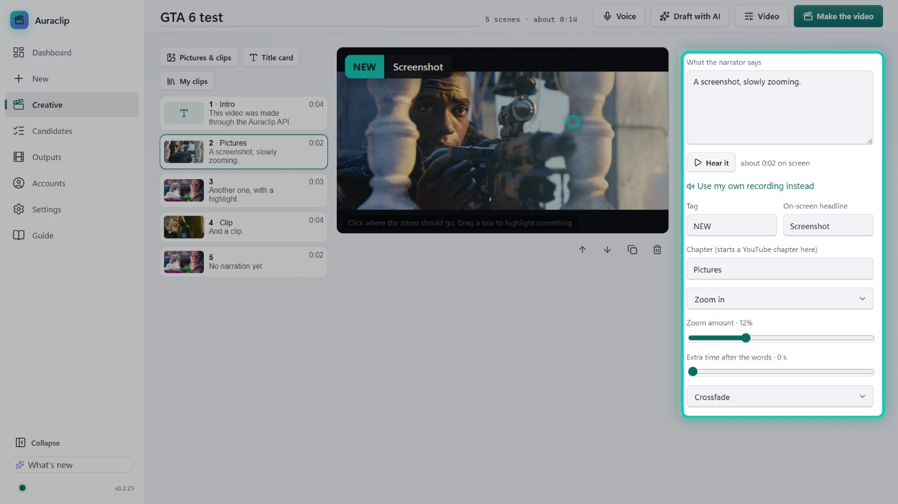
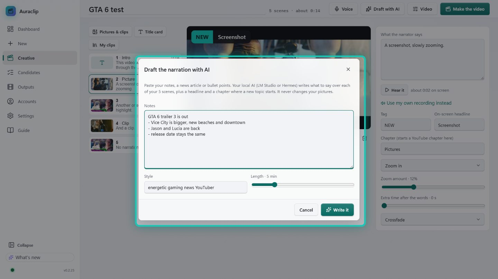
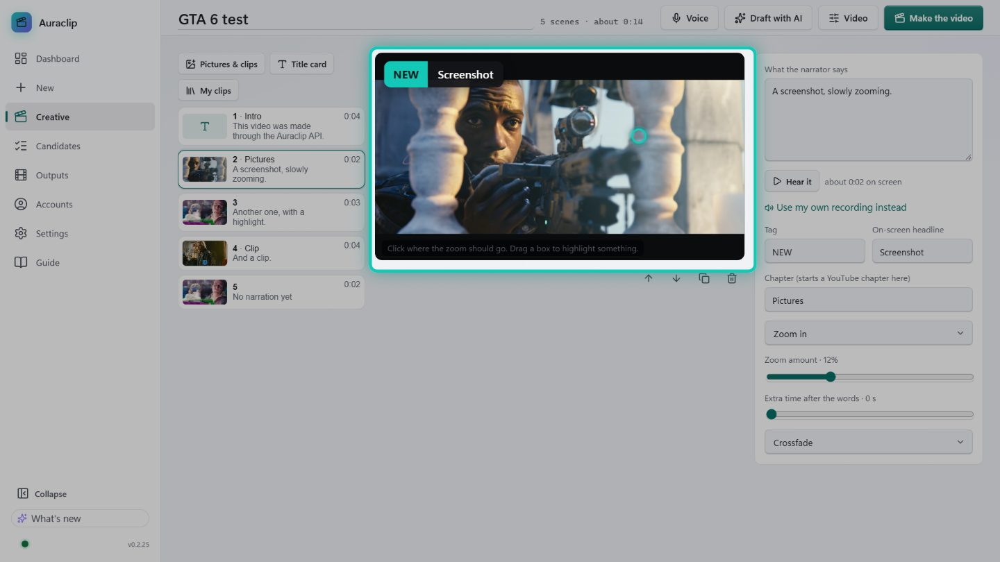
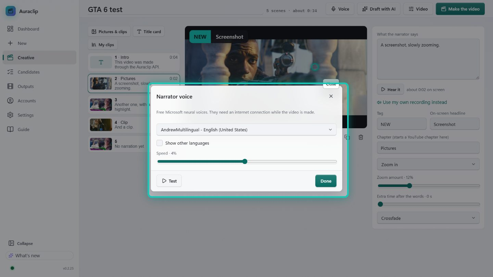
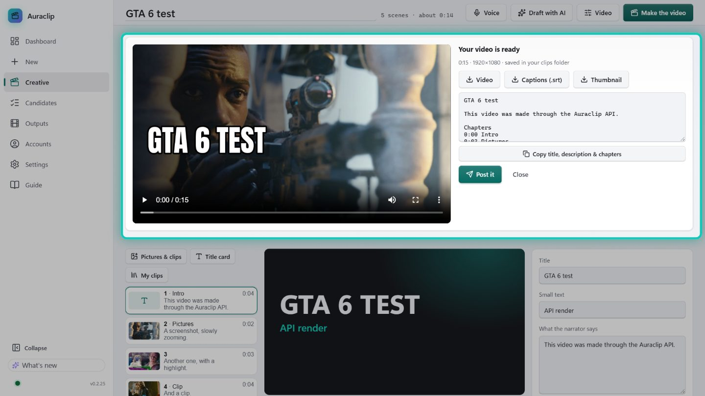

# 4 · Creative: long YouTube videos from your screenshots and clips

**Creative** makes a narrated 16:9 YouTube video, with no long video to clip. It suits news recaps,
"everything new in GTA 6", tier lists and explainers. You bring pictures and clips; Auraclip adds:
- an AI narrator (free Microsoft neural voices);
- a slow zoom on every picture;
- captions, chapters and your branding;
- a thumbnail.

Then you post it to YouTube.

## Step 1 · Start a video
Click **Creative** in the left menu (right under **New**), then **New video**. Click the title at the top
to rename it.

## Step 2 · Add pictures and clips
- **Drop** screenshots (PNG, JPG, WebP) and clips (MP4, MOV, MKV, WebM) anywhere on the page, or press
  **Pictures & clips**. Each file becomes a scene.
- **Title card** adds a big-text scene, great for the intro and the outro.
- **My clips** adds a clip you already made in Auraclip (your best GTA moments).
- Reorder scenes by dragging them, or with the arrows under the preview.

## Step 3 · Say something over each scene
Select a scene and type **What the narrator says**. Press **Hear it** to listen. The narration sets how
long the scene stays on screen.

- **Tag + On-screen headline** shows a news-style label top left, e.g. `NEW` · *Vice City is huge*.
- **Chapter** starts a YouTube chapter at that scene. Name 3 or more and YouTube shows chapters.
- **Use my own recording instead:** upload your own voice for that scene.

### Or let the AI write it
Press **Draft with AI**, paste your notes or a news article, and press **Write it**. Your local AI
(LM Studio or Hermes, see [guide 3](03-local-ai-and-agents.md)) writes for every scene:
- the narration;
- a headline;
- chapters.

It also writes the YouTube title, the description and the hashtags. Read it and change anything you like.
Without an AI, your notes are shared out over the scenes.

## Step 4 · Zooms and highlights
On a picture, **click** where the slow zoom should go, or **drag a box** to highlight something. Everything
else dims and a teal ring fades in around it. Per scene you choose:
- **Motion:** zoom in, zoom out, pan or still, and how far it zooms.
- **Extra time after the words.**
- How the scene starts: **crossfade**, **dip to black** or **cut**.

For a clip: press **Start here** / **End here** while it plays to trim it, and set how loud its own sound
plays under the narrator.

## Step 5 · Voice and video settings
- **Voice:** pick the narrator (300+ voices, many languages) and the speed, then press **Test**. The
  default for new videos is in **Settings → Clip defaults → Creative voice**.
- **Video:**
  - captions style;
  - colour filter;
  - your logo and username;
  - thumbnail text and picture;
  - YouTube title, description and hashtags;
  - background music, ducked under the voice.

## Step 6 · Make the video and post it
Press **Make the video**. Auraclip reads the narration, builds every scene, joins them and masters the
sound to YouTube's loudness. When it's done you get:
- the video (1080p) plus a **captions file** and a **thumbnail**, also in your clips folder under
  `videos/`;
- the **title, description, chapters and hashtags**, ready to copy;
- **Post to YouTube:** check the text and press **Post now**. It goes up as a normal (long) YouTube video,
  with your thumbnail when your channel allows custom thumbnails.

> The narrator voice needs an internet connection while the video is made. Creative is a Pro feature:
> 3 free videos, unlimited with a licence. Hearing the voice is always free.

Next: [Troubleshooting](troubleshooting.md)
